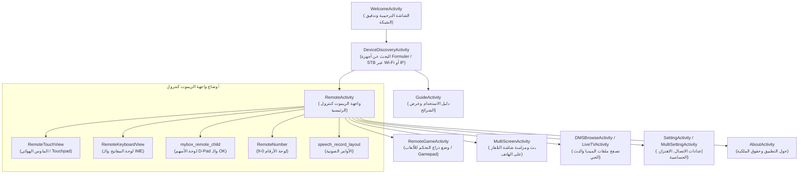

# تقرير التحليل التقني والاستكشافي — تطبيق Air Sync Remote Z
> **المسار المستهدف:** `c:\Users\zfj_d\Desktop\air-sync\air-sync-remote-z`  
> **تاريخ التقرير:** 2026-10-24  
> **حالة التقرير:** التقرير الرسمي المعتمد (التحليل والاستكشاف الفني فقط)

---

## 1. نظرة عامة وهوية التطبيق الحقيقية

| المعيار | التفاصيل التقنية الدقيقة المستخرجة |
|---|---|
| **اسم التطبيق (Application Label)** | **Air Sync Remote Z** (الاسم الصيني: 魔视 Z) |
| **اسم الحزمة (Package Name)** | `com.aloys.formuler.airsyncremote` |
| **فئة التطبيق (Application Class)** | `com.aloys.formuler.airsyncremote.MyApp` |
| **رمز الإصدار (Version Code)** | `10` |
| **اسم الإصدار (Version Name)** | `Beta 9` |
| **بيئة البناء الأصلية** | Android Gradle Plugin `2.3.3` عبر ADT / Android Studio القديم |
| **إصدار منصة البناء (Build Platform)** | Android 4.4.2 KitKat (API 19 - `4.4.2-1456859`) |
| **الحد الأدنى للنظام (minSdkVersion)** | **API 9** (Android 2.3 Gingerbread) |
| **النظام المستهدف (targetSdkVersion)** | **API 19** (Android 4.4 KitKat) |
| **ملف الكود المجمع (DEX)** | `classes.dex` بحجم **2.76 MB** (يحتوي 2,612 Class) |
| **جدول الموارد (Resources Table)** | `resources.arsc` بحجم **69.7 KB** |
| **الشركة المصنعة / المطورة** | Aloys Inc. بالتعاون مع HiSilicon Technologies (Huawei) لأجهزة Formuler STB |

---

## 2. فحص بنية التطبيق والمجلدات (Application Structure)

يتكون المجلد `air-sync-remote-z` من الهيكلية القياسية لتطبيق أندرويد مفكوك عبر أدوات التفكيك (Unpacked APK):

```
air-sync-remote-z/
├── AndroidManifest.xml          ← ملف المانيفست الثنائي المترجم (AXML)
├── classes.dex                  ← كود Dalvik القابل للتنفيذ (2.76 MB)
├── resources.arsc               ← جدول الموارد والمعرفات المترجم (69.7 KB)
├── META-INF/                    ← تواقيع وتفاصيل البناء الأصلية
│   ├── MANIFEST.MF              (Created-By: Android Gradle 2.3.3 / Built-By: Generated-by-ADT)
│   ├── CERT.SF
│   └── CERT.RSA
├── org/                         ← موارد حزم UPnP / Cling الخارجية
│   └── teleal/
│       ├── cling/               (مخططات XSD لخدمات وأجهزة UDA 1.0 و 1.1)
│       └── common/              (مخططات XHTML/XML وأيقونات التسجيل والـ logging)
├── lib/                         ← المكتبات البرمجية الأصلية (Native C/C++ Libraries)
│   └── armeabi-v7a/             (بنية 32-bit فقط)
│       ├── libairmouse_jni.so         (13.5 KB - محرك الماوس الهوائي JNI)
│       ├── libHME-Video.so            (4.04 MB - محرك الفيديو الخاص بـ HiSilicon)
│       ├── libHME_VideoEngine_jni.so  (42.5 KB - واجهة JNI لمحرك الفيديو)
│       ├── libmirror40_jni.so         (4.58 MB - محرك مزامنة وبث الشاشة لأندرويد 4.0)
│       ├── libmirror44_jni.so         (4.59 MB - محرك مزامنة وبث الشاشة لأندرويد 4.4)
│       └── libmirror50_jni.so         (4.55 MB - محرك مزامنة وبث الشاشة لأندرويد 5.0)
└── res/                         ← مجلد الموارد المفتوحة (غير المبهمة)
    ├── anim/                    (مؤثرات الحركة والانتقال fade, slide, speech_record)
    ├── drawable/                (محددات الحالات والأزرار ومسارات الـ Drawables)
    ├── drawable-nodpi-v4/       (أيقونات النظام العامة)
    ├── drawable-xhdpi-v4/       (أيقونات الريموت، أزرار التحكم، ومؤشرات الاتصال بدقة عالية)
    ├── layout/                  (56 ملف تصميم XML لواجهات التطبيق والريموت ومشغلات الوسائط)
    ├── raw/                     (أيقونة icon.png، ونغمة التسجيل الصوتي speech.ogg)
    └── xml/                     (preferences.xml لإعدادات التطبيق)
```

---

## 3. فحص مكتبات جوجل، خدمات Google Play، وواجهات البرمجة المهملة (Deprecated APIs)

### 3.1 مكتبات جوجل وخدمات Google Play
من خلال الفحص الدقيق لكافة التوقيعات وسلاسل النصوص في `classes.dex` و `AndroidManifest.xml`:
- **Google Play Services:** **0** (غير مستخدمة إطلاقاً؛ لا توجد أي مكتبات لـ GMS مثل Ads, Auth, FIDO, Location, أو Drive).
- **Firebase SDKs:** **0** (غير مستخدمة إطلاقاً؛ لا يوجد FCM أو Analytics أو Crashlytics).
- **مكتبة الدعم من جوجل (Google Android Support):**
  - استخدام **`android.support.v4`** (إصدار قديم جداً يعود لعام 2014-2016 قبل ظهور AndroidX). يضم 307 فئات (مثل `Fragment`, `FragmentActivity`, `FragmentManager`, `AccessibilityServiceInfoCompat`).
  - **غياب تام لمكتبات AndroidX و Jetpack الحديثة**.

### 3.2 المكتبات البرمجية الخارجية المكتشفة في الكود

| المكتبة / الحزمة | عدد الفئات | الدور الفني | الحالة |
|---|---|---|---|
| `org.teleal.cling` | 673 فئة | إطار عمل UPnP / DLNA للاتصال بأجهزة التلفاز والرسيفر | قديم ومتوقف التطوير (مهجور لصالح مكتبات أحدث) |
| `com.hisilicon.dlna` | 333 فئة | نواة DLNA DMC (Digital Media Controller) من هاي سيليكون | مخصصة لشرائح HiSilicon |
| `com.hisilicon.multiscreen` | 130 فئة | بروتوكول الشاشات المتعددة، الماوس الهوائي، والمزامنة | مخصصة لبيئات HiSilicon STB |
| `org.cybergarage.upnp / http` | 119 فئة | مكدس بروتوكول CyberLink UPnP للشبكات المنزلية | قديم جداً |
| `org.apache.http` | 56 فئة | عميل Apache HTTP Client القديم المضمن في Android KitKat | **مُزال بالكامل من نظام أندرويد منذ أندرويد 6.0/9.0** |
| `com.huawei.videoengine` | 14 فئة | محرك فك تشفير وعرض الفيديو المباشر | مكتبة مغلقة المصدر لشركة Huawei |

### 3.3 الواجهات والـ APIs القديمة أو الـ Deprecated الحرجة

> [!WARNING]
> يعتمد التطبيق على منظومة تقنية من حقبة أندرويد 2.3 إلى 4.4، مما يجعله غير قابل للتثبيت أو التشغيل على إصدارات أندرويد الحديثة (Android 14 و Android 15) بالأوضاع الافتراضية للأسباب التالية:

1. **انعدام معمارية 64-bit (Missing 64-bit ABI):**
   - التطبيق يحتوي فقط على `lib/armeabi-v7a/` (32-bit).
   - المعالجات الحديثة وأجهزة أندرويد 14+ (مثل Pixel 7/8/9 وسلاسل هواتف حديثة أخرى) أسقطت دعم تشغيل 32-bit بالكامل، مما يمنع تشغيل ملفات `.so` المضمنة نهائياً.
2. **استهداف نظام تشغيل متقادم جداً (`targetSdkVersion: 19`):**
   - متطلبات متجر Google Play الحالية تفرض `targetSdkVersion 34+`.
   - نظام أندرويد 14 فما فوق يقوم بحظر تثبيت أي تطبيق يستهدف إصدار أقل من API 23 تلقائياً (`INSTALL_FAILED_DEPRECATED_SDK_VERSION`).
3. **نموذج أذونات ما قبل أندرويد 6 (No Runtime Permissions):**
   - يعتمد كلياً على أذونات التثبيت القديمة في المانيفست. لا توجد أي أكواد لطلب الأذونات الحساسة وقت التشغيل (`requestPermissions` / `checkSelfPermission`) للأذونات الحساسة التالية:
     - `RECORD_AUDIO` (التسجيل الصوتي للأوامر)
     - `CAMERA` و `FLASHLIGHT` (استخدام الكاميرا)
     - `WRITE_EXTERNAL_STORAGE` و `READ_EXTERNAL_STORAGE` (التخزين الخارجي غير المتوافق مع Scoped Storage في أندرويد 10+)
     - `READ_PHONE_STATE`
     - `SYSTEM_ALERT_WINDOW`
4. **الاعتماد على مكتبة `org.apache.http`:**
   - تم حذف هذه المكتبة في أندرويد 6.0 (API 23) وتم تعطيل دعمها نهائياً.
5. **استخدام مكتبات المرايا الخاصة بالأنظمة القديمة:**
   - وجود ملفات JNI موجهة لأنظمة محددة: `libmirror40_jni.so` (لأندرويد 4.0)، `libmirror44_jni.so` (لأندرويد 4.4)، `libmirror50_jni.so` (لأندرويد 5.0). هذه الملفات تعتمد على استدعاءات داخلية خاصة لنواة `SurfaceFlinger` تم تغييرها كلياً في إصدارات أندرويد اللاحقة (لا سيما مع قيود NDK و Hidden APIs من أندرويد 9+).
6. **واجهات الـ Hardware القديمة:**
   - استخدام `android.hardware.Camera` المهملة بدلاً من `Camera2` الحديثة.
   - استخدام `PreferenceActivity` بدلاً من `PreferenceFragmentCompat`.
   - استخدام `android.net.NetworkInfo` بدلاً من `ConnectivityManager.NetworkCallback`.
   - طلب أذونات مهملة مثل `android.permission.RESTART_PACKAGES` و `GET_TASKS`.

---

## 4. هيكلية الواجهات الحالية (UI/UX Architecture)

### 4.1 نمط التصميم ونظام الواجهة
- **نظام الواجهات:** مبني بالكامل على **Android Views الكلاسيكية** عبر ملفات XML (لا أثر لـ Jetpack Compose أو ViewBinding أو DataBinding).
- **التصميم العام:** نمط التصميم يتبع واجهات العصر المظلم المتدرج (Skeuomorphic / Glossy Dark UI) السائد في حقبة أندرويد 4.x، باللون الرمادي والأسود مع أزرار ذات تدرجات لونية وحدود مميزة.
- **التنقل (Navigation):** قائم على استدعاء مباشر لـ `Intent` بين الـ Activities، مع نوافذ منبثقة مخصصة (`PopupWindow`) ومربعات حوار من نوع `DialogUtils`.

### 4.2 الشاشات والأنشطة الرئيسية (Activities Map)



### 4.3 تفاصيل الواجهات الوظيفية للمستخدم

1. **واجهة البحث عن الأجهزة (`DeviceDiscoveryActivity` / `device_dis.xml`):**
   - فحص شبكة Wi-Fi المحلية واكتشاف أجهزة STB المدعومة عن طريق UPnP M-SEARCH ومطابقة خدمات HiSilicon.
   - إمكانية الإدخال اليدوي لعنوان IP في حال عدم ظهور الجهاز تلقائياً.
2. **واجهة الريموت كنترول المتعددة (`RemoteActivity` / `mybox_remote.xml`):**
   - **الشريط العلوي (`mybox_remote_head.xml`):** يحتوي على اسم الجهاز المتصل وزر للتبديل السريع بين أوضاع التحكم.
   - **الوضع الكلاسيكي (Directional D-Pad):** أزرار للأعلى، للأسفل، لليمين، لليسار، وزر OK الأوسط.
   - **شريط الوظائف السفلي (`mybox_remote_bottom.xml`):** أزرار التشغيل/إيقاف التشغيل (Power)، التحكم بمستوى الصوت (Vol+/Vol-)، القنوات (Ch+/Ch-)، والرجوع (Back)، القائمة (Menu)، والرئيسية (Home).
   - **وضع الماوس الهوائي واللمس (`RemoteTouchView`):** منطقة لمس مسطحة لتحريك المؤشر كفأرة، مع استغلال حساس الجيروسكوب عبر ميزة "رج الهاتف لتفعيل الماوس الهوائي" (Shake to Air Mouse).
   - **وضع لوحة المفاتيح (`RemoteKeyboardView` و `ContentInputActivity`):** مزامنة إدخال النصوص من الهاتف إلى حقول الإدخال في التلفاز مباشرة.
   - **وضع لوحة الأرقام (`RemoteNumber`):** إدخال أرقام القنوات والرموز السرية.
   - **الأوامر الصوتية (`speech_record_layout.xml`):** الضغط والتحدث لتسجيل الصوت وإرساله للرسيفر لتنفيذ العمليات.
3. **واجهة ذراع الألعاب (`RemoteGameActivity` / `mybox_remote_game.xml`):**
   - تحويل الهاتف بالعرض إلى Gamepad افتراضي بأزرار A/B/X/Y وأسهم اتجاهات للتحكم في ألعاب الأندرويد المثبتة على الرسيفر.
4. **واجهة مزامنة شاشة التلفاز (`MultiScreenActivity` / `mybox_image_control.xml`):**
   - عرض شاشة التلفاز مباشرة على شاشة الهاتف للتحكم باللمس أو المشاهدة في غرفة أخرى، مدعومة بمحرك `HME-Video`.
5. **واجهات مشاركة الوسائط والبث المباشر (DLNA / DMS):**
   - `LiveTVActivity`: استعراض قنوات البث الفضائي/الأرضي المتاحة على الرسيفر واختيارها من الهاتف.
   - `DMSBrowseActivity` و `FoldersActivity`: تصفح وتشغيل الفيديو (`PlayingVideoActivity`)، الصور (`PlayingImageActivity`)، والموسيقى (`PlayingMusicActivity`) عبر بروتوكول DLNA.

---

## 5. ملخص المكونات البرمجية المسجلة في الـ Manifest

- **عدد الأنشطة (Activities):** 17 نشاطاً.
- **عدد الخدمات الخلفية (Services):** 4 خدمات:
  - `MultiScreenControlService` (خدمة الاتصال والتحكم المتعدد)
  - `VImeClientControlService` (خدمة مزامنة لوحة المفاتيح الافتراضية VIME)
  - `SensorService` (خدمة قراءة حساسات الحركة والماوس الهوائي)
  - `CoreUpnpService` (خدمة مكدس الـ UPnP الأساسية)
- **مزودات المحتوى (Content Providers):** مزود واحد `PlaylistProvider` (`com.aloys.formuler.data.playlistprovider`) لإدارة قوائم التشغيل عبر قاعدة بيانات SQLite محلية.

---

## 6. الاستنتاج الفني العام

التطبيق الحالي هو نسخة أصلية من تطبيق **Air Sync Remote Z (Beta 9)** مصمم خصيصاً لأجهزة رسيفرات Formuler العاملة بمعالجات HiSilicon.  
التطبيق **مكتمل المزايا من حيث المنطق الوظيفي** (ريموت شامل، بث شاشة، ماوس هوائي، مشاركة وسائط)، إلا أنه **متأخر تقنياً بحوالي عقد كامل** من ناحية إصدارات أندرويد (KitKat API 19)، وهو غير مجهز لمعمارية 64-bit، ولا يستوفي شروط ومعايير التوافق مع أنظمة أندرويد الحديثة (Android 14 و 15).

---
*تم إيقاف العمل عند هذه النقطة التزاماً بالتعليمات، وفي انتظار توجيهاتك للمرحلة القادمة.*
